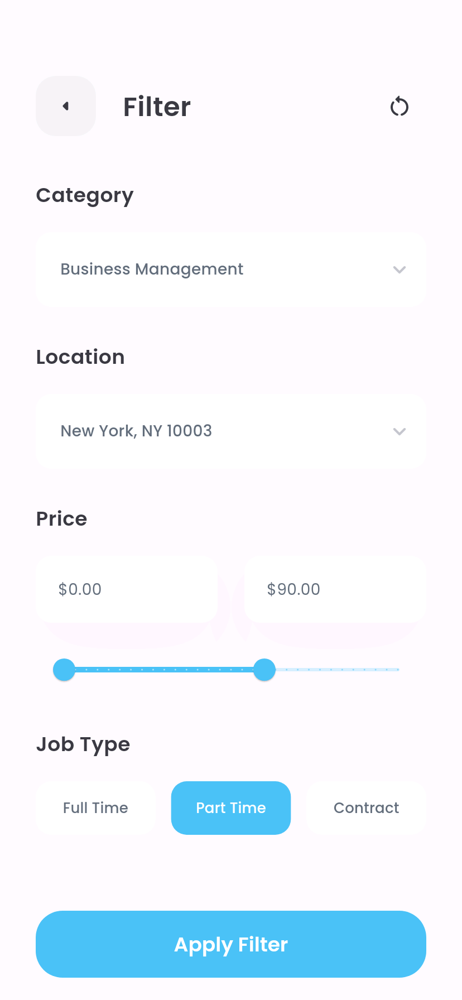
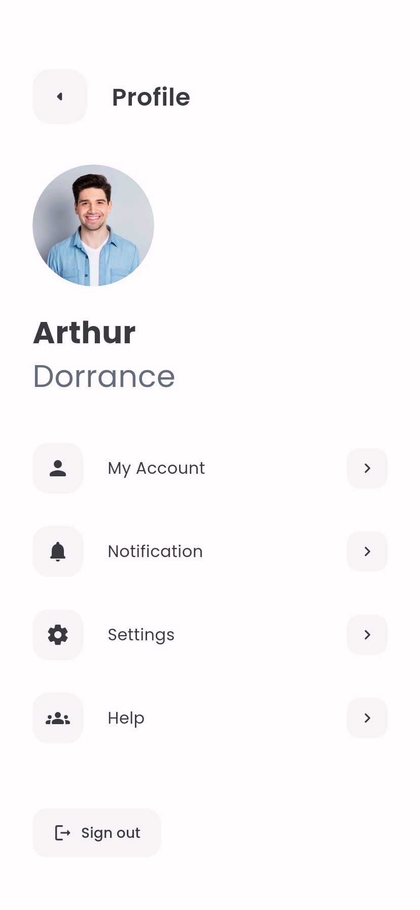
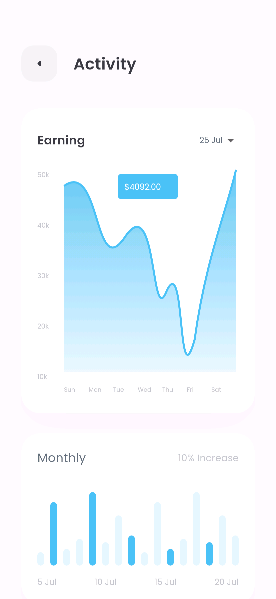

# Job Finder · Flutter 求职 App

根据 Pixso「Job Finder Figma」开发的 Flutter 应用，覆盖 **1 个页面分类、30 张画板**。复用设计稿原始插画、照片和 Poppins 字体，保留浅蓝主色、圆角卡片和留白；重复画板合并为页面的空白、填写和页签状态。

这是可以离线运行的 UI 与交互演示：搜索、筛选、收藏、申请记录、资料编辑和设置可以实际操作并保存。招聘、身份验证、定位与支付尚未连接真实服务。

## 主要界面

以下图片来自 Android 模拟器中实际运行的 App，原始 Pixso 设计稿单独保存。

| 职位首页 | 职位详情 |
| --- | --- |
|  |  |

| 分类浏览 | 组合筛选 |
| --- | --- |
|  |  |

| 个人中心 | 收益活动 |
| --- | --- |
|  |  |

[全部截图](docs/SCREENSHOTS.md) · [设计实现对照](docs/DESIGN_MAPPING.md) · [测试记录](docs/VALIDATION.md)

安装包：[Android 手机 ARM64](releases/job-finder-arm64-v8a.apk) · [Android 模拟器 x86_64](releases/job-finder-x86_64.apk) · [全部安装包说明](releases/README.md)

## 功能范围

| 模块 | 实现 |
| --- | --- |
| 引导与登录 | 三步引导、首次启动记录、登录注册、表单校验、密码显隐、记住登录、第三方演示入口 |
| 密码与手机号 | 邮箱输入、四位验证码、95 秒倒计时及到期重发、重置密码校验、手机号保存 |
| 职位发现 | 推荐职位、最近发布、热门列表、分类搜索与六类展示 |
| 搜索筛选 | 关键词、历史搜索、评分排序、类别/位置/时薪/工作类型组合筛选、无结果状态 |
| 职位详情 | Description / Map / Review、展开文字、收藏、申请确认、防重复申请 |
| 收藏与申请 | 收藏列表、取消收藏、申请记录 |
| 个人与设置 | 编辑资料、明暗主题、通知偏好、语言选择、帮助、关于、退出 |
| 通知与活动 | 通知详情、已读保存、收益折线和月度柱状图、日期切换 |
| 支付与地图 | 支付方式选择、银行卡校验、卡面联动、路线示意、缩放与复位 |

修正了原稿少量英文拼写，如 Catagory → Category、Proce → Price、Discription → Description；注册按钮改为含义正确的 Sign Up。

## 项目结构

~~~text
JobFinderApp/
├── lib/
│   ├── main.dart                         # 初始化与启动
│   ├── app.dart                          # AppScope、主题、命名路由
│   ├── core/theme.dart                   # 设计配色、字体、明暗主题
│   ├── data/
│   │   ├── jobs.dart                     # Job、JobFilter、数据与搜索筛选
│   │   └── app_state.dart                # 全局状态与本地持久化
│   ├── widgets/ui.dart                   # 页面框架、导航、表单、卡片、按钮
│   └── features/
│       ├── auth/auth_pages.dart          # 引导、账户入口、验证码
│       ├── discovery/discovery_pages.dart # 首页、搜索、分类、筛选与列表
│       ├── jobs/job_pages.dart           # 详情、申请与地图
│       ├── account/account_pages.dart    # 个人、设置、通知、活动与帮助
│       └── payments/payment_pages.dart   # 支付方式、银行卡及校验
├── assets/
│   ├── fonts/                            # Poppins 与字体许可证
│   └── images/                           # 从 Pixso 导出的独立素材
├── test/
│   ├── core_test.dart                    # 数据、持久化及校验测试
│   └── layout_test.dart                  # 两种屏幕尺寸的布局检查
├── integration_test/app_flow_test.dart    # 模拟器流程测试与截图
├── test_driver/screenshots.dart           # 保存模拟器截图
├── tools/build_gallery.py                 # 截图总览和索引生成
├── docs/
│   ├── design/                           # 原始设计稿和节点记录
│   ├── screenshots/                      # App 实际运行截图
│   ├── DESIGN_MAPPING.md                 # 30 张画板对应关系
│   ├── SCREENSHOTS.md                    # 截图索引
│   └── VALIDATION.md                     # 环境及验证结果
├── releases/                             # 可安装 Android APK
├── android/                              # Android 工程
├── ios/                                  # iOS 工程
└── web/                                  # Flutter Web 入口
~~~

## 架构与数据流

按功能组织文件，使用 Flutter 自带 ChangeNotifier 和 InheritedNotifier，仅增加 SharedPreferences 一个运行时依赖。

~~~mermaid
flowchart TD
  A["main.dart 初始化"] --> B["AppState.load 读取本地状态"]
  B --> C["JobFinderApp / AppScope"]
  C --> D["主题与集中路由"]
  D --> E["功能页面"]
  E --> F["公共 UI 组件"]
  E --> G["JobFilter 与搜索函数"]
  E --> H["AppState 状态操作"]
  H --> I["notifyListeners 更新界面"]
  H --> J["SharedPreferences 本地保存"]
  I --> E
~~~

- **展示层**：页面维护输入框、页签、筛选草稿等短期状态，公共组件统一样式与交互。
- **数据层**：Job 与 JobFilter 为不可变模型；搜索筛选函数不依赖界面，便于测试和替换为接口。
- **应用状态**：AppState 管理资料、收藏、申请、历史、通知及主题，变更后刷新依赖页面。
- **本地存储**：仅保存非敏感演示数据。密码、验证码、完整卡号和 CVC 不落盘；新增卡片只存末四位。
- **导航**：集中定义路由；筛选页通过返回值更新搜索页，独立进入时转至结果页。

| 路由 | 页面 |
| --- | --- |
| /onboarding、/login、/signup | 引导、登录与注册 |
| /forgot、/otp、/reset、/phone | 找回密码、验证与手机号 |
| /home、/search、/categories、/popular | 职位发现 |
| /filter、/job、/map | 筛选、详情与地图 |
| /saved、/applications | 收藏与申请 |
| /profile、/account、/settings | 个人中心、资料与设置 |
| /notifications、/activity、/help | 通知、活动与帮助 |
| /payments、/card | 支付方式与银行卡 |

## 运行与验证

验证环境：Flutter **3.47.7**、Dart **3.13.5**、Android 15 / API 35 模拟器。建议使用相同 Flutter 版本，依赖版本由 pubspec.lock 固定。

~~~bash
flutter pub get
flutter run -d emulator-5554
~~~

首次显示三步引导，然后进入登录；勾选 Remember me 后，下次启动恢复演示登录。第三方入口可直接体验演示账户。

| 用途 | 演示输入 |
| --- | --- |
| 登录 | arthurdorrance@gmail.com / Preview123，仅校验格式 |
| 找回密码 | 验证码 7900，不实际发送邮件 |
| 银行卡 | 4111111111111111 / 12/30 / 768，请使用测试数据 |

~~~bash
# 静态检查与本地测试
flutter analyze
flutter test

# 模拟器交互测试与全页面截图
flutter drive --driver=test_driver/screenshots.dart --target=integration_test/app_flow_test.dart -d emulator-5554 --enable-software-rendering --no-enable-impeller

# 截图总览，需要 Python 与 Pillow
python tools/build_gallery.py

# Android 安装包
flutter build apk --release --split-per-abi

# 浏览器预览
flutter run -d chrome
~~~

截图使用 828×1792 像素、320 dpi 的模拟器，对应设计稿 414×896 逻辑尺寸。另检查了 320×640 小屏布局；较长页面可滚动。为贴近画板采用全屏展示，顶部留白避开常见摄像头区域。

## 演示边界与后续接入

职位、通知、评价与收益均为示例；分类中的职位数量沿用设计稿，不代表本地记录条数。应用不会向招聘方发送申请或实际扣款。

尚未接入：身份认证、OAuth、邮件/短信验证、真实招聘接口、简历上传、推送通知、地图定位导航与支付服务。通知开关仅保存应用偏好；语言仅提供设计稿的 English；地图是离线路线示意，不能读取实时位置。密码找回展示交互与校验，不修改服务器密码。

后续可将职位数据替换为服务接口，为 AppState 注入账户/存储服务，并用真实 SDK 替换身份、地图与支付入口。收益图表直接本地绘制，避免为了简单图形引入大型库。

Android release 包使用开发签名供安装验收，正式上架需配置自有签名。iOS 工程已生成，但本次 Windows 环境未进行 iOS 编译或真机验证。Web 提供运行入口，主要验收平台为 Android。

## 素材与精简

插画与人物照片来自用户提供的 Pixso 文件，已本地化，无需联网加载。Poppins 采用 SIL Open Font License，见 assets/fonts/OFL.txt。原始 Pixso 素材分发授权由设计权利人决定。

已去除计数器示例、未使用的 Cupertino 图标依赖及冗余模板说明。表单、导航、按钮和卡片共用实现；同页不同状态不复制源码。缓存及构建目录由 .gitignore 排除，安装包放在 releases。
