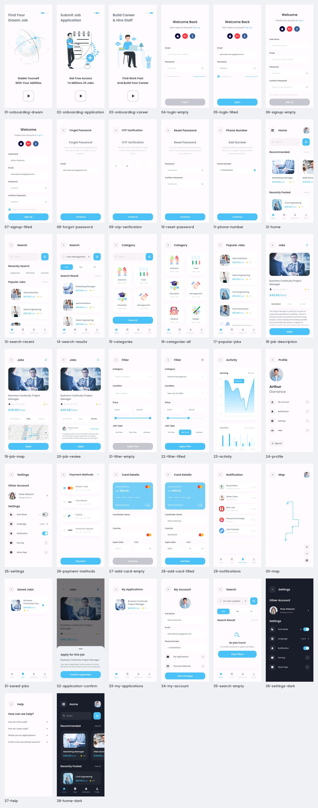

# 界面截图索引

以下截图由 Android 15 模拟器运行 Flutter App 后直接生成，原始大小为 828 × 1792 像素。
对应 414 × 896 的设计尺寸；这是实际页面截图，不是设计稿导出。

| 序号 | 界面 / 状态 | 原始截图 |
| --- | --- | --- |
| 01 | onboarding dream | [查看截图](screenshots/01-onboarding-dream.png) |
| 02 | onboarding application | [查看截图](screenshots/02-onboarding-application.png) |
| 03 | onboarding career | [查看截图](screenshots/03-onboarding-career.png) |
| 04 | login empty | [查看截图](screenshots/04-login-empty.png) |
| 05 | login filled | [查看截图](screenshots/05-login-filled.png) |
| 06 | signup empty | [查看截图](screenshots/06-signup-empty.png) |
| 07 | signup filled | [查看截图](screenshots/07-signup-filled.png) |
| 08 | forgot password | [查看截图](screenshots/08-forgot-password.png) |
| 09 | otp verification | [查看截图](screenshots/09-otp-verification.png) |
| 10 | reset password | [查看截图](screenshots/10-reset-password.png) |
| 11 | phone number | [查看截图](screenshots/11-phone-number.png) |
| 12 | home | [查看截图](screenshots/12-home.png) |
| 13 | search recent | [查看截图](screenshots/13-search-recent.png) |
| 14 | search results | [查看截图](screenshots/14-search-results.png) |
| 15 | categories | [查看截图](screenshots/15-categories.png) |
| 16 | categories all | [查看截图](screenshots/16-categories-all.png) |
| 17 | popular jobs | [查看截图](screenshots/17-popular-jobs.png) |
| 18 | job description | [查看截图](screenshots/18-job-description.png) |
| 19 | job map | [查看截图](screenshots/19-job-map.png) |
| 20 | job review | [查看截图](screenshots/20-job-review.png) |
| 21 | filter empty | [查看截图](screenshots/21-filter-empty.png) |
| 22 | filter filled | [查看截图](screenshots/22-filter-filled.png) |
| 23 | activity | [查看截图](screenshots/23-activity.png) |
| 24 | profile | [查看截图](screenshots/24-profile.png) |
| 25 | settings | [查看截图](screenshots/25-settings.png) |
| 26 | payment methods | [查看截图](screenshots/26-payment-methods.png) |
| 27 | add card empty | [查看截图](screenshots/27-add-card-empty.png) |
| 28 | add card filled | [查看截图](screenshots/28-add-card-filled.png) |
| 29 | notifications | [查看截图](screenshots/29-notifications.png) |
| 30 | map | [查看截图](screenshots/30-map.png) |
| 31 | saved jobs | [查看截图](screenshots/31-saved-jobs.png) |
| 32 | application confirm | [查看截图](screenshots/32-application-confirm.png) |
| 33 | my applications | [查看截图](screenshots/33-my-applications.png) |
| 34 | my account | [查看截图](screenshots/34-my-account.png) |
| 35 | search empty | [查看截图](screenshots/35-search-empty.png) |
| 36 | settings dark | [查看截图](screenshots/36-settings-dark.png) |
| 37 | help | [查看截图](screenshots/37-help.png) |
| 38 | home dark | [查看截图](screenshots/38-home-dark.png) |

## Pixso 参考

原始 30 张设计画板保存在 [design](design/) 中，页面映射见 [设计实现对照](DESIGN_MAPPING.md)。
